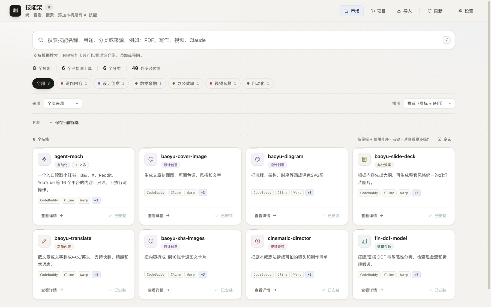
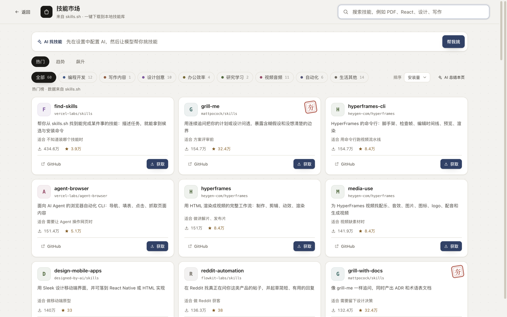
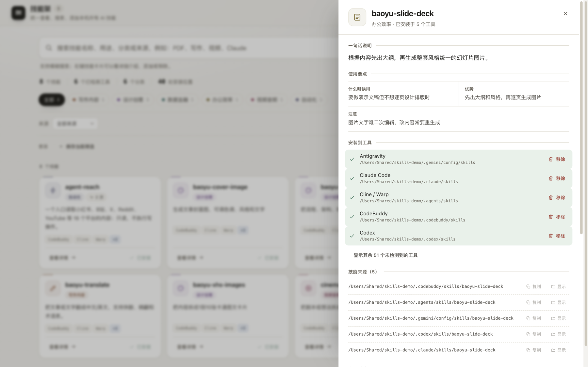

# 技能架 · Skills Shelf

**一个窗口，管好你所有 AI Agent 的 Skills。**

[](https://github.com/zhuoyulang-123456/skills-shelf/releases)
[](LICENSE)
[](#下载)
[](https://github.com/zhuoyulang-123456/skills-shelf/actions/workflows/build.yml)
[](#支持的-agent)

如果你同时用 Claude Code、Codex、Cursor、OpenCode、WorkBuddy……你大概已经有一堆散落在 `~/.claude/skills`、`~/.codex/skills`、`.cursor/skills` 里的技能：**装了哪些、哪个是干嘛的、改过没有，全靠记忆**。

技能架把这些目录合成一个书架：

- **一个窗口看全**：50+ 款 Agent、几十上百个技能，合并、去重、标来源；
- **说人话**：129 条人工撰写的中文简介，写清「能做什么、什么时候用、优势和坑」；
- **装一次，到处用**：同一个技能一键复制 / 软链到任意 Agent，也能一键移除；
- **不止本机**：内置 skills.sh 市场，热门 / 趋势 / 飙升榜，中文摘要，一键下载；
- **本地优先**：扫描、搜索、安装都在本机完成，不上传技能内容；AI 是可选项。

> 我们在做这个工具时的目标很简单：**如果只能留一个 Skills 管理器，它应该是技能架。**
> 不追求功能堆砌，而是把「找得到、看得懂、装得上、删得掉」这四件事做到位。



## 为什么是技能架

| 你现在的做法 | 技能架 |
|---|---|
| 手动在十几个 `~/.xxx/skills` 之间翻文件夹 | 一次扫描 50+ 款 Agent，合并成卡片，标出装在哪几个工具 |
| 英文 `SKILL.md` 看得半懂，装完就忘 | 中文简介 + 使用场景 + 优势/注意，右键即看 |
| 同一个技能要在每个工具里复制一遍 | 多选 + 一次添加到多个 Agent，失败自动回退 |
| 想删又怕删错 | 详情里按 Agent 逐个移除，默认进废纸篓 |
| 只知道自己装过什么 | 逛 skills.sh 榜单，中文摘要，一键下载到中央库 |
| 依赖在线服务、登录、上传 | 全本地运行；AI Key 存系统钥匙串，可完全不开 AI |

**它不是某个 Agent 的插件，而是所有 Agent 的公共书架。**

## 界面预览

| 技能市场：skills.sh 榜单 + 中文摘要 | AI 找技能：一句话挑出合适技能 |
|---|---|
|  |  |

| 技能详情：装在哪些 Agent、逐个移除 | 设置：目录、安装方式、AI 与 Key |
|---|---|
|  |  |

> 截图使用演示数据（8 个技能 / 6 个 Agent / 40 处安装位置），不是任何人的真实目录。

## 下载

到 [Releases](https://github.com/zhuoyulang-123456/skills-shelf/releases) 下载对应平台的包：

| 平台 | 文件 |
|---|---|
| macOS（Apple Silicon） | `Skills-Shelf-*-arm64.dmg` |
| Windows x64 | `Skills-Shelf-Setup-*-x64.exe`（安装版）<br>`Skills-Shelf-Portable-*-x64.exe`（免安装） |
| Linux x64 | `Skills-Shelf-*-x86_64.AppImage`<br>`Skills-Shelf-*-amd64.deb` |
| Linux arm64 | `Skills-Shelf-*-arm64.AppImage`<br>`Skills-Shelf-*-arm64.deb` |

包**未做代码签名**（个人项目，证书成本太高），首次打开时：

- macOS：右键 → 打开，或到「系统设置 → 隐私与安全性」放行；也可 `xattr -dr com.apple.quarantine "/Applications/Skills Shelf.app"`。
- Windows：SmartScreen 提示时点「更多信息 → 仍要运行」。
- Linux：AppImage 需 `chmod +x`；极简系统若缺 `libz.so`，安装 `zlib1g-dev` 或直接用 deb。

也可以从源码运行：

```bash
git clone https://github.com/zhuoyulang-123456/skills-shelf.git
cd skills-shelf
npm install
npm start
```

## 功能

### 书架：扫描与整理
- **50+ 款 Agent**（56 个目录目标，见下方列表）自动发现，路径不存在就标记「未检测到」，不会误建目录。
- 同一个技能装在多个工具里时合并成一张卡，徽标显示来源；内容不一致时标「多版本」。
- 按名称、简介和正文关键词自动归入 9 个分类：编程开发、写作内容、设计创意、数据金融、办公效率、研究学习、视频音频、自动化、生活其他。
- **模糊搜索**：中文、英文、路径、来源都能搜；`/` 聚焦搜索框。
- 右键卡片：详情、添加、移除、在文件夹中显示、复制路径。
- 自定义技能目录；关联项目根目录，自动识别项目内的 `.claude/skills`、`.codex/skills`、`skills`。

### 安装：一次到位
- 复制或软链接安装；Windows 上软链自动尝试 junction，失败回退复制。
- 多选卡片批量添加到多个 Agent；详情里按 Agent 逐个移除，默认进废纸篓。
- **套装（Preset）**：把当前筛选结果存成套装，之后一键批量应用。
- **中央技能库**：`~/.skills-manager/skills`，导入本地技能文件夹，或从市场下载。
- **配置备份**：导出 / 导入目录、套装、安装方式（不含技能文件）。

### 市场：skills.sh 中文版
- 热门 / 趋势 / 飙升三个榜单，10 个分类，按安装量或星标排序。
- 每张卡一句话功能 + 一行适用场景；热门榜内置中文摘要，长尾自动抽取/翻译并缓存 7 天。
- 一键下载到中央库，再一键装进任意 Agent。
- GitHub 星标数直接显示；星标 ≥ 100,000 的技能盖「夯」章，并参与推荐排序。
- 本机调用次数统计（来自 Claude Code / OpenCode 会话），只存本地。

### AI：可选，不是必需品
- **AI 找技能**：描述任务，让模型从当前候选里挑出合适的技能并说明理由。
- **AI 语义摘要**：为长尾技能生成「功能 + 适用场景」，可单条或批量。
- 内置 DeepSeek、MiniMax、小米 MiMo、智谱 GLM、Kimi、通义千问、硅基流动、OpenRouter、Gemini、OpenAI，以及自定义 OpenAI 兼容接口。
- 支持测试连接、保存 Key；Key 用系统钥匙串（macOS Keychain / Windows DPAPI / Linux libsecret）加密，**不写日志、不进导出配置**。

## 支持的 Agent

Claude Code、Codex、Cursor、OpenCode、GitHub Copilot、Gemini CLI、Antigravity、Windsurf、Cline、Warp、CodeBuddy、WorkBuddy、WorkBuddy AI、Qoder、TRAE、TRAE CN、Kimi Code CLI、Qwen Code、DeepSeek Harness、MiniMax Code、Doubao、Roo Code、Kilo Code、Continue、Droid、Goose、Amp、Replit、Augment、OpenClaw、OMP Agent、Grok、Deep Agents、Firebender、IBM Bob、Command Code、Cortex Code、Crush、iFlow CLI、Junie、Kiro CLI、Kode、MCPJam、Mistral Vibe、Mux、Neovate、OpenHands、Pi、Pochi、Zencoder、ZCode、AdaL、Hermes Agent、QClaw、EasyClaw、AutoClaw、GitLab Duo。

> 目录规则都在 `electron/main.mjs` 的 `AGENTS` 里；新增一个 Agent 通常只需加一行。

## 平台验证

- **macOS arm64**：本机实测通过（0.5.4）。
- **Windows 11 x64**：Portable 与 NSIS 安装版实测通过（0.5.4）：扫描、刷新后重新检测新建的工具目录、市场、GitHub 下载、覆盖升级、快捷方式。
- **Linux arm64**：Docker Desktop 的 Linux VM 实测通过（0.5.4）：AppImage 与 deb 启动、市场、分类、下载、扫描、添加/移除。
- **Linux x64**：已构建，未在真实 x64 桌面单独运行（与 arm64 同一套代码）。

Windows 上应用内网络会跟随系统代理（Electron `net.fetch`），Clash 等代理环境无需额外配置。

## 开发

```bash
npm install
npm start          # 运行
npm run check      # 语法检查
```

打包：

```bash
npm run dist        # macOS dmg（当前机器 arm64）
npm run dist:win    # Windows：NSIS 安装版 + Portable
npm run dist:linux  # Linux x64：AppImage + deb
```

CI 在 `.github/workflows/build.yml`：macOS arm64（`macos-15`）、Windows x64、Linux x64、Linux arm64（`ubuntu-24.04-arm`）四平台并行构建；推 `v*` 标签自动发 Release，也可在 Actions 里手动触发。

<details>
<summary>目录结构</summary>

```
skills-shelf/
├── electron/main.mjs       # Agent 注册表、扫描、归类、安装/移除、市场、AI、IPC
├── electron/preload.cjs    # 暴露给渲染层的安全 API
├── renderer/               # 原生 HTML/CSS/JS 界面
├── data/skill-summaries.json    # 129 条本机技能中文简介
├── data/market-summaries.json   # 市场榜单中文摘要
├── scripts/build-win.mjs   # 跨平台生成 Windows 安装版 / 免安装版
├── build/                  # 图标与图标生成脚本
├── docs/FEATURES.md        # 功能清单与设计取舍
├── docs/screenshots/       # README 截图与社交预览图
├── docs/WINDOWS-RECORDING.md  # Windows 录屏/截图指南
├── scripts/record-kit/     # 演示数据、启动、CDP 截图脚本
└── CHANGELOG.md            # 版本记录
```

</details>

## 数据与安全

- 设置保存在 Electron `userData`（macOS：`~/Library/Application Support/Skills Shelf/settings.json`）。
- 扫描只读 `SKILL.md` 与目录结构，不上传任何内容。
- 添加/移除只操作你勾选的工具目录；移除默认进废纸篓。
- AI 关闭时不会发起任何模型请求；开启后只发送技能名称与描述给所选服务商。
- 图标与名称仅用于描述兼容的工具，与各 Agent 厂商无隶属关系。

## License

[MIT](LICENSE)

---

**English**: Skills Shelf is a cross-platform desktop manager for AI agent skills. It scans 50+ agents, merges duplicates, explains every skill in Chinese, searches fuzzily, installs/removes across agents in one click, and browses the skills.sh marketplace with summaries. Local-first, AI optional, open source.
